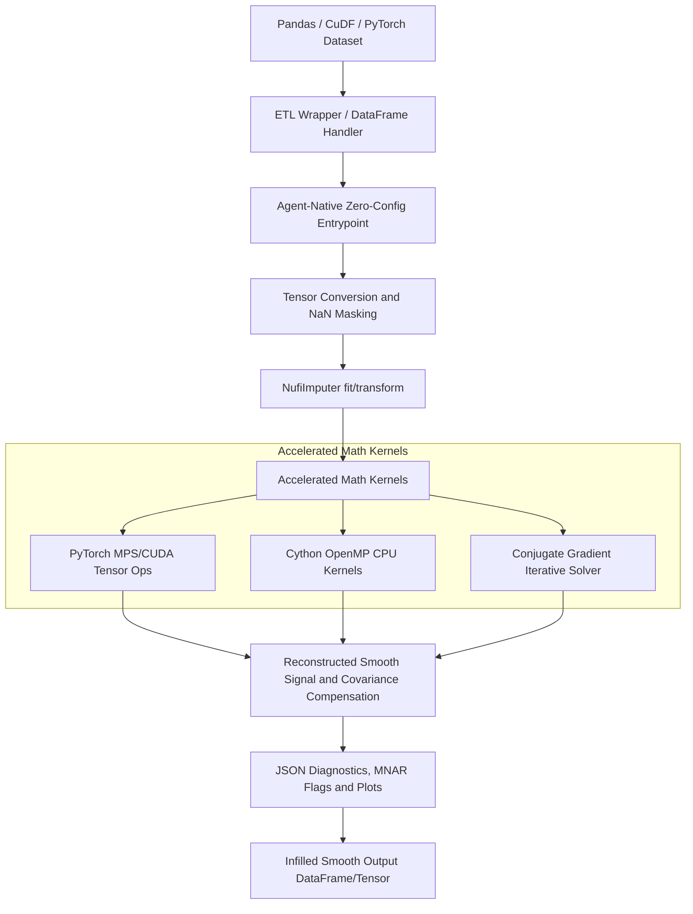
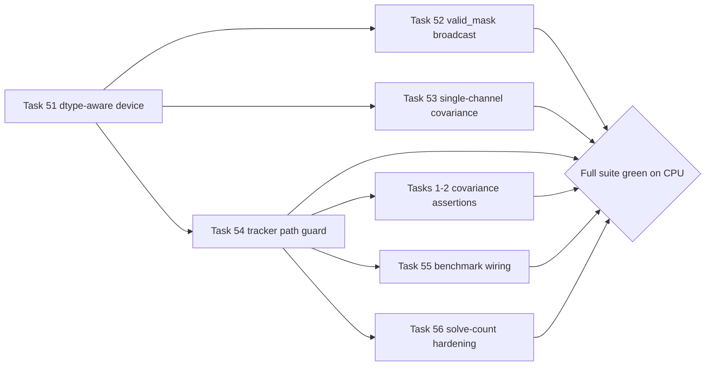

# PLAN.md - Product Requirement Document (PRD) and Execution Plan

> **Revision 2** - updated after completion and verification of the Clinical MNAR Sensitivity Suite (Tasks 46-50, commit `06c716e`).
> Revision 1 (the original core-library PRD) is preserved in git history; its PR-1 to PR-4 requirements are retained below with delivery status.

---

## 1. Overview and Goal

Build and harden `nufi` (Non-Uniform Fourier Infilling): a high-performance, GPU-accelerated (PyTorch MPS/CUDA) Python/Cython library for infilling non-uniformly sampled multi-dimensional time series via Tikhonov-regularized NUDFT spectral reconstruction with LDLᵀ covariance-compensated stochastic posterior injection.

Unlike linear or polynomial interpolation, which introduce derivative discontinuities, the Fourier-basis reconstruction is infinitely differentiable and preserves all derivatives of the infilled signal.

The library is now functionally complete through the Clinical MNAR Sensitivity Suite (Pattern Mixture Models, Reference-Based MI, Tipping Point Analysis, Rubin Rules pooling, Diggle-Kenward dropout diagnostics).

**Current goal (Phase 12)**: close the outstanding acceptance gate of that epic - `PYTHONPATH=. pytest passes 100%` - by fixing four pre-existing infrastructure defects (Tasks 51-54), hardening two fragile legacy tests (Tasks 1-2), and completing two Task 46-50 follow-ups (Tasks 55-56). This work is tracked in TASKLIST.md ids 51-56 and in the GitHub issue: 🩹 [Bug / Test Infrastructure] Pre-existing NUDFT/MPS/tracker failures block the "PYTHONPATH=. pytest passes 100%" acceptance gate (Tasks 51-56 + existing Tasks 1-2).

Design pillars (unchanged): theoretically rigorous for PhD data scientists, highly robust for enterprise engineers, and agent-native for autonomous LLM workflows.

---

## 2. Product Requirements (PRD)

### PR-1: Core Mathematics and Infilling Quality - DELIVERED
- **Non-Uniform Spectral Analysis**: 1D and multi-dimensional NUDFT plus fast variants.
- **Derivative Preservation**: trigonometric basis keeps first, second, and N-th derivatives continuous.
- **Covariance Preservation**: frequency-domain covariance compensation with LDLᵀ decomposition.
- **NaN Tolerance**: graceful masking/imputation of NaN values.
- **Tikhonov (L2) Regularization**: regularized spectral solvers for clustered timestamps.
- **Iterative CG Solver**: O(N log N) iterative solver in PyTorch.
- **Stochastic Multiple Imputation**: posterior draws with batch support (`n_imputations=M`).
- **Auto-Tuning**: GCV selection of frequency bins and regularization.

### PR-2: Agent-Native Architecture - DELIVERED
- **Zero-Config Entrypoints**: `impute_dataframe` with auto-detected timestamps, columns, missingness.
- **JSON-Serializable Diagnostics**: SNR, spectral entropy, stability flags, optimized alpha, frequency count.
- **Diagnostic Visualizations**: `plot_diagnostics()` and `plot_tipping_point()`.

### PR-3: Peer-Reviewed Theory and Rigorous Benchmarking - DELIVERED
- **LaTeX Whitepaper**: `nufi/paper/main.tex`, now including the Clinical MNAR Sensitivity section (Spectral PMM, CIR Fourier integrals, Tipping Point + Rubin Rules) with Carpenter/Roger/Kenward 2013, Diggle/Kenward 1994, and Barnard/Rubin 1999 citations.
- **Empirical Benchmarks**: NUFI vs MICE vs Gaussian Processes vs splines (RMSE, covariance discrepancy, runtime).

### PR-4: Transformation Logging, Quality Enforcement and Version Tracking - DELIVERED
- **Append-Only Logging**: `nufi_transformations.log` with per-transformation metadata.
- **Quality Enforcement**: `TransformationLoggingError` halts the transaction on any logging failure.
- **Snapshot Versioning**: `TransformationTracker` snapshots in `.nufi_history/` with list/revert.

### PR-5: Clinical MNAR Sensitivity Suite - DELIVERED (Tasks 46-50, commit 06c716e)
- **Pattern Mixture Models**: `mnar_strategy` (`pmm_shift`, `pmm_slope`, `spectral_dampening`) with `delta_adjustment` (float, dict, ndarray); observed data strictly invariant.
- **Reference-Based MI**: `infill_rbmi_dataframe` supporting CR, J2R, CIR, LMCF across Pandas and cuDF with LDLᵀ covariance preservation.
- **Tipping Point Analysis**: `run_tipping_point_analysis` over 1D/2D delta grids with zero redundant NUDFT solves per grid coordinate, plus `plot_tipping_point`.
- **Batch MI and Pooling**: `transform(..., n_imputations=M)` vectorized posterior draws; `pool_rubins_rules` with Barnard-Rubin degrees of freedom, FMI, t-stat, p-value, CI.
- **MNAR Diagnostics**: `MNAR_DROPOUT_LEVEL_BIAS` / `MNAR_DROPOUT_SLOPE_BIAS` flags from closed-form Fourier derivatives.

### PR-6: Test Infrastructure Reliability and Reproducibility - ACTIVE (Tasks 51-56 + legacy Tasks 1-2)
- **Device Portability**: the suite must run on Apple Silicon with the stock default device (dtype-aware selection).
- **Kernel Correctness**: no broadcast failures when `n_f != N_val`; single-channel covariance compensation must not crash.
- **Agent I/O Robustness**: `TransformationTracker` must accept explicit user-provided paths (e.g. tempdirs) via an opt-in flag without weakening the default guard.
- **Benchmark Completeness**: the MNAR dropout benchmark must be wired into `__main__` and cover the planned three-way comparison.
- **Verification Strength**: solve-count assertions must not be able to pass vacuously.
- **Definition of Done**: `PYTHONPATH=. pytest` passes 100% on CPU.

---

## 3. High-Level Technical Architecture



---

## 4. Implementation Status (Phases 1-12)

- **Phase 1: Project Setup and Boilerplate** (COMPLETED)
- **Phase 2: PyTorch Accelerated GPU Kernels** (COMPLETED)
- **Phase 3: Cython CPU Kernels** (COMPLETED)
- **Phase 4: Scikit-Learn Imputer Core** (COMPLETED)
- **Phase 5: ETL Data Wrappers** (COMPLETED)
- **Phase 6: LaTeX Whitepaper Formulation** (COMPLETED)
- **Phase 7: Advanced Solvers and Imputation** (COMPLETED)
- **Phase 8: Agent-Native Layer** (COMPLETED)
- **Phase 9: Empirical Benchmark Suite** (COMPLETED)
- **Phase 10: Validation, Tests and Device Benchmarking** (COMPLETED)
- **Phase 11: Clinical MNAR Sensitivity Suite - Tasks 46-50** (COMPLETED, commit `06c716e`; verification found the suite implemented correctly but blocked by pre-existing defects - see 5.0)
- **Phase 12: Test Infrastructure Hardening - Tasks 51-56 + Tasks 1-2** (PLANNED - detailed below)

---

## 5. Phase 12 Execution Plan: Test Infrastructure Hardening (Tasks 51-56)

### 5.0 Evidence Base (measured 2026-10-17, pyenv 3.12.3)

| Run | Suite | Result |
|---|---|---|
| HEAD `06c716e`, MPS disabled (CPU) | 37 tests | 28 failed, 9 passed |
| Parent `a70523d` (pre-epic), MPS disabled | 28 tests | 22 failed, 6 passed |
| HEAD `06c716e`, stock default device (MPS) | 37 tests | 35 failed, 2 passed |

All 22 parent-commit failures reproduce identically at HEAD, so none are regressions from the MNAR epic. The 6 additional failures are the new Task 47/48/50 tests, and each is blocked by a pre-existing defect below rather than by the new logic (which was verified in isolation: `pool_rubins_rules` matches Barnard-Rubin reference values to rtol 1e-6; `compute_mnar_offsets` and `evaluate_fourier_derivative` were validated directly against finite differences).

### 5.1 Task 51 - dtype-aware device selection

- **Location**: `nufi/kernels/torch_kernels.py:5-17` (`get_device`)
- **Root cause**: `get_device()` returns `torch.device("mps")` whenever MPS is available, but the pipeline hard-codes `float64`/`complex128` (e.g. `impute.py:124`). MPS does not support float64, so every fit/transform on Apple Silicon raises `TypeError: Cannot convert a MPS Tensor to float64 dtype`. This alone accounts for 35 of 37 failures with the stock device.
- **Fix**: probe float64 capability and fall back to CPU; support a `NUFI_DEVICE` env override; document in README.

```python
      elif torch.backends.mps.is_available():
-         return torch.device("mps")
+         override = os.environ.get("NUFI_DEVICE")
+         if override:
+             return torch.device(override)
+         try:
+             torch.zeros(1, dtype=torch.float64, device="mps")
+             return torch.device("mps")
+         except (RuntimeError, TypeError):
+             return torch.device("cpu")
```

- **Unblocks**: the entire suite on Apple Silicon with the stock default device.
- **Risk**: silent CPU fallback may surprise performance expectations; mitigated by the env override, a README note, and (optionally) a one-time warning.

### 5.2 Task 52 - fix valid_mask broadcast in solve_tikhonov_nudft

- **Location**: `nufi/kernels/torch_kernels.py:376-377`
- **Root cause**: `valid_mask = ~np.isnan(timestamps) & ~np.isnan(data) & ~np.isnan(f_k)` ANDs the frequency-grid mask (length `n_f`) into the per-sample mask (length `N`). When the GCV fallback selects `n_f != N_val` (see the `impute.py:164` warning), shapes `(N,) & (N,) & (n_f,)` raise `ValueError: operands could not be broadcast together with shapes (3,) (2,)`.
- **Fix**: validate `f_k` separately; never AND it into the sample mask.

```python
-     valid_mask = ~np.isnan(timestamps) & ~np.isnan(data) & ~np.isnan(f_k)
-     valid_mask &= ~np.isinf(timestamps) & ~np.isinf(data) & ~np.isinf(f_k)
+     if not np.all(np.isfinite(f_k)):
+         raise ValueError("f_k contains NaN/inf frequency values.")
+     valid_mask = ~np.isnan(timestamps) & ~np.isnan(data)
+     valid_mask &= ~np.isinf(timestamps) & ~np.isinf(data)
```

- **Unblocks**: `test_imputer_numpy`, `test_imputer_pandas`, `test_stochastic_imputation`, `test_stochastic_imputation_multicol`, and short-series wrapper/RBMI fits.
- **Risk**: non-finite `f_k` now raises instead of being silently folded into the mask - intended, explicit failure is preferable.

### 5.3 Task 53 - single-channel covariance compensation

- **Location**: `nufi/kernels/torch_kernels.py:226-229,251`
- **Root cause**: for one signal, `np.array([concatenate([arr.real, arr.imag])]).T` is `(2N, 1)`, so `np.cov(flat_data, rowvar=False)` returns a 0-d array (`shape ()`), and `np.diag(covariance_matrix)` raises `ValueError: Input must be 1- or 2-d.` Reproduced with 8 samples.
- **Impact**: any single-outcome fit with `covariance_compensation=True` crashes; all four `test_rbmi_dataframe_methods[CR/J2R/CIR/LMCF]` tests fail because `infill_rbmi_dataframe` fits the default `NufiImputer()` on the 1-column reference-mean trajectory (`wrappers.py:459` -> `impute.py:193`).
- **Fix**: `np.atleast_2d` plus an identity short-circuit (a single channel has no cross-channel covariance to preserve), returning identity LDLᵀ factors over the doubled real+imag space.

```python
-     covariance_matrix = np.cov(flat_data, rowvar=False)
+     covariance_matrix = np.atleast_2d(np.cov(flat_data, rowvar=False))
+     if covariance_matrix.shape == (1, 1):
+         n = len(X_list)
+         return np.eye(2 * n), np.eye(2 * n), np.arange(n), np.arange(2 * n)
```

- **Unblocks**: the four RBMI method tests; single-channel `NufiImputer(covariance_compensation=True)` fits.
- **Risk**: single-channel compensation becomes a no-op - semantically correct, since there is no cross-channel structure to preserve.

### 5.4 Task 54 - TransformationTracker path guard (macOS tempdirs)

- **Location**: `nufi/agent.py:33-41`
- **Root cause**: the guard requires `os.path.commonpath([realpath(cwd), resolved]) == realpath(cwd)` for both `log_path` and `history_dir`. On macOS `tempfile.mkdtemp()` returns `/var/folders/...` (symlink to `/private/var/folders/...`), outside the CWD, so all 11 `tests/test_agent.py` tracker/`impute_dataframe`/tipping-point tests fail with `ValueError: Path ... is outside the allowed directory (possibly on a different drive).` regardless of their assertions.
- **Fix**: make containment an opt-in safety default (`allow_outside_cwd` parameter backed by `NUFI_ALLOW_UNSAFE_PATHS`), and/or validate `log_path` containment against the `history_dir` root instead of the CWD. Update tests to stay inside the CWD or set the flag.

```python
      def __init__(self, log_path: str = "nufi_transformations.log",
-                  history_dir: str = ".nufi_history"):
+                  history_dir: str = ".nufi_history",
+                  allow_outside_cwd: bool = None):
+         if allow_outside_cwd is None:
+             allow_outside_cwd = os.environ.get(
+                 "NUFI_ALLOW_UNSAFE_PATHS", ""
+             ).strip().lower() in ("1", "true", "yes")
          safe_root = os.path.realpath(os.getcwd())
          for p in (log_path, history_dir):
+             if allow_outside_cwd:
+                 break
              resolved = os.path.realpath(p)
```

- **Unblocks**: all `tests/test_agent.py` tracker, `impute_dataframe`, MNAR diagnostics, and tipping point tests.
- **Risk**: security relaxation must remain opt-in; the default behavior for relative/agent-driven paths is unchanged.

### 5.5 Task 55 - wire the MNAR dropout benchmark into __main__ and restore its scope

- **Location**: `tests/benchmark.py:245-258,261-305`
- **Root cause**: `run_mnar_dropout_benchmark` (Task 50) is defined but never invoked anywhere (grep matches only its def line); the `__main__` block runs only `run_benchmarks` + `print_benchmark_results`. Additionally the implemented benchmark only exercises `infill_rbmi_dataframe(rbmi_method="CIR", n_imputations=1, stochastic=False)`, whereas the Task 46-50 plan specified a three-way comparison - naive MAR `NufiImputer`, `NufiImputer(mnar_strategy="pmm_slope")`, and RBMI-CIR - reporting treatment-effect bias, RMSE, covariance error, and runtime.
- **Fix**: call `run_mnar_dropout_benchmark` from `__main__`, merge its results into the saved JSON, and add the MAR and PMM arms scored against the simulated truth (`truth[subj]` final visit).
- **Unblocks**: full delivery of Task 50 acceptance.
- **Risk**: none functional; benchmark-only.

### 5.6 Task 56 - harden the tipping-point solve-count assertions

- **Location**: `tests/test_agent.py:291-320`
- **Correction to an earlier review note**: the patch target IS currently effective. `impute.py:245-246` re-imports `solve_tikhonov_nudft` inside `transform()` at call time, so patching `nufi.kernels.torch_kernels.solve_tikhonov_nudft` intercepts the per-arm solves (2 calls per analysis: one transform per arm, one outcome column each). The existing `small_calls == big_calls` check is therefore a genuine 2 == 2 comparison today.
- **Fragility**: the test never asserts the counter is greater than zero. If a future refactor hoists that import to `impute.py` module level, the patch stops intercepting, the counter silently drops to 0, and `0 == 0` still passes - the exact vacuous scenario the check exists to prevent. The path is also currently unexercised on macOS (Task 54 guard).
- **Fix**: assert a non-zero, grid-size-independent budget:

```python
          self.assertEqual(small_calls, big_calls)
+         # One transform per arm (one outcome column each): the count must be
+         # non-zero AND independent of the delta-grid size (2x2 vs 2x9).
+         self.assertGreaterEqual(small_calls, 2)
+         self.assertLessEqual(big_calls, 8)
          self.assertEqual(res_big["treatment_effects"].shape, (2, 9))
```

- **Risk**: the constants (2 and 8) are tied to the current 2-arm / 1-outcome trial fixture; update them if the fixture changes.

### 5.7 Legacy Tasks 1-2 - fragile test_covariance assertions

- **Location**: `tests/test_covariance.py:46-49` (Task 1) and `:79-80` (Task 2)
- **Root cause**: cross-method comparisons (Fourier vs linear interpolation, compensated vs uncompensated) are sampling-noise sensitive with only 50 samples and about 20 percent missingness.
- **Fix**: replace with analytic bounds (scaled by signal amplitude and Nyquist) for Task 1, and a tolerance-margin comparison (1.05x) for Task 2, as already drafted in the TASKLIST entries.
- **Unblocks**: `test_derivative_continuity[direct|cg]`, `test_covariance_preservation[direct|cg]`.

### 5.8 Execution Order and Dependency Graph

Recommended order: 51 (device) first so every subsequent run is reproducible on this machine, then 52 and 53 (independent kernel fixes), then 54, then 1-2, then 55 and 56, then the final full-suite gate.



---

## 6. Verification Protocol and Acceptance Criteria

**Environment**: pyenv 3.12.3 (`~/.pyenv/versions/3.12.3/bin/python`) with torch 2.14.1, scipy 1.18.1, scikit-learn 1.9.1, matplotlib 3.11.2, numpy 2.2.6, pandas 2.2.3, pytest 8.3.5 (installed 2026-10-17 during verification - these were previously missing).

**Local workaround until Task 51 lands** (the stock default device selects MPS and crashes on float64):

```python
import torch
torch.backends.mps.is_available = lambda: False
import pytest, sys
sys.exit(pytest.main(["-q"]))
```

**Per-fix gates** (run after each task):

| After | Command | Expected |
|---|---|---|
| Task 51 | `NUFI_DEVICE=cpu PYTHONPATH=. python -m pytest -q` | collection succeeds with stock device; no MPS float64 TypeError |
| Task 52 | `PYTHONPATH=. python -m pytest tests/test_imputer.py -q` | numpy/pandas/stochastic tests pass |
| Task 53 | `PYTHONPATH=. python -m pytest tests/test_imputer.py -q -k rbmi` | all four RBMI parametrizations pass |
| Task 54 | `PYTHONPATH=. python -m pytest tests/test_agent.py -q` | all tracker/impute_dataframe/tipping tests pass |
| Tasks 1-2 | `PYTHONPATH=. python -m pytest tests/test_covariance.py -q` | all four parametrizations pass |
| Task 55 | `python tests/benchmark.py` | MNAR section printed and saved with three-way comparison |
| Task 56 | `PYTHONPATH=. python -m pytest tests/test_agent.py -q -k tipping` | passes with a non-zero counter assertion in place |

**Final gate**: `PYTHONPATH=. python -m pytest -q` reports **0 failed** on CPU (currently 28 failed / 9 passed), and a stock-device run no longer raises the float64 TypeError (currently 35 failed / 2 passed). The exact per-test unblock mapping above is a prediction - re-verify at implementation time, since some tests (e.g. `test_imputer_edge_cases`) may depend on more than one fix.

---

## 7. Risks, Tradeoffs and Out of Scope

- **CPU fallback vs float32 rewrite (Task 51)**: a float32 port of the whole pipeline would be a much larger change with precision loss in spectral solves; dtype-probing with CPU fallback is the minimal correct fix.
- **Guard relaxation (Task 54)**: the path containment guard is a genuine safety feature for agent-driven writes; relaxation must be opt-in via parameter or env var, never removed.
- **Identity short-circuit (Task 53)**: single-channel covariance compensation becomes a no-op by design; cross-channel behavior is untouched.
- **Explicit errors over silent masks (Task 52)**: non-finite `f_k` now raises; preferable to silent corruption.
- **TASKLIST.md is not strict XML**: bare `&` appears in pre-existing `<title>` lines, so tooling must not assume ElementTree parseability; validate structurally instead.
- **Out of scope**: no new imputation features; no changes to the infilling mathematics beyond the Task 52/53 bug fixes; cuDF/GPU-CUDA paths remain untested on this machine (no CUDA device).

---

## 8. References

- `TASKLIST.md` ids 1, 2 (legacy) and 51-56 (this epic)
- Commits: `06c716e` (MNAR epic, Tasks 46-50), `a70523d` (pre-epic baseline used for the regression A/B run)
- GitHub issue to file: 🩹 [Bug / Test Infrastructure] Pre-existing NUDFT/MPS/tracker failures block the "PYTHONPATH=. pytest passes 100%" acceptance gate (Tasks 51-56 + existing Tasks 1-2)
- Verification date: 2026-10-17 (test matrix in 5.0 measured on this machine)
