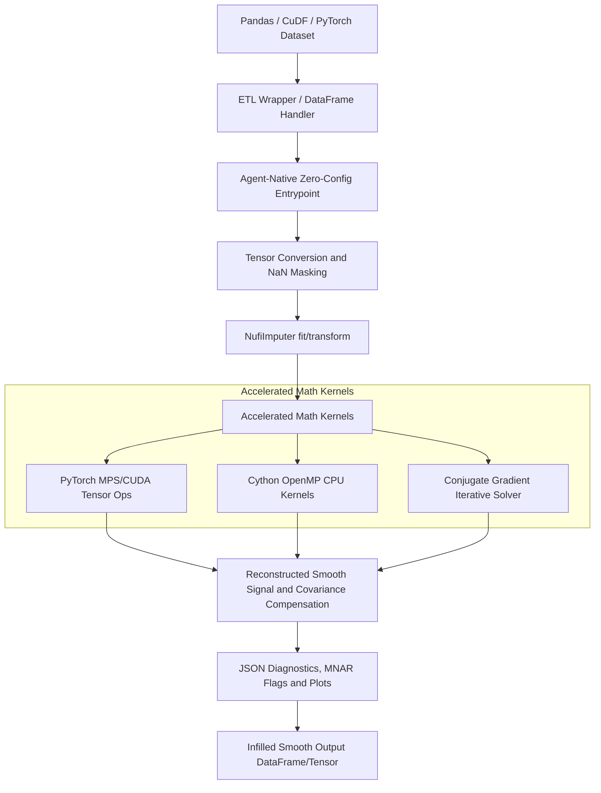
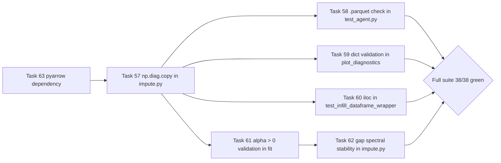

# PLAN.md - Product Requirement Document (PRD) and Execution Plan

> **Revision 3** - updated after completion and verification of Phase 12 Test Infrastructure Hardening (Tasks 51–56, commit `0c3bc59`).
> Revision 1 (the original core-library PRD) and Revision 2 (Phase 11/12 plan) are preserved in git history; PR-1 through PR-6 requirements and delivery status are retained below.

---

## 1. Overview and Goal

Build and harden `nufi` (Non-Uniform Fourier Infilling): a high-performance, GPU-accelerated (PyTorch MPS/CUDA) Python/Cython library for infilling non-uniformly sampled multi-dimensional time series via Tikhonov-regularized NUDFT spectral reconstruction with LDLᵀ covariance-compensated stochastic posterior injection.

Unlike linear or polynomial interpolation, which introduce derivative discontinuities, the Fourier-basis reconstruction is infinitely differentiable ($C^\infty$) and preserves all derivatives of the infilled signal.

**Current goal (Phase 13)**: Resolve the final **14 pre-existing pytest failures** (and 1 missing dependency declaration) uncovered once the Phase 12 device/broadcast/guard blockers were cleared in commit `0c3bc59`, bringing `PYTHONPATH=. pytest -q` from **24 passed / 14 failed (38 total)** to **38 passed / 0 failed (100% green)**. This work is tracked in `TASKLIST.md` ids 57–63 and in the GitHub issue: *🩹 [Bug / Test Suite] Resolve remaining 14 pre-existing pytest failures to reach 100% green suite (Tasks 57–63)*.

Design pillars (unchanged): theoretically rigorous for PhD data scientists and biostatisticians, highly robust for enterprise engineers, and agent-native for autonomous LLM workflows.

---

## 2. Product Requirements (PRD)

### PR-1: Core Mathematics and Infilling Quality - DELIVERED
- **Non-Uniform Spectral Analysis**: 1D and multi-dimensional NUDFT plus fast Gaussian-gridding variants.
- **Derivative Preservation**: trigonometric basis keeps first, second, and $N$-th derivatives continuous.
- **Covariance Preservation**: frequency-domain covariance compensation with LDLᵀ decomposition.
- **NaN Tolerance**: graceful masking/imputation of NaN values.
- **Tikhonov (L2) Regularization**: regularized spectral solvers for clustered timestamps.
- **Iterative CG Solver**: $O(N \log N)$ iterative solver in PyTorch.
- **Stochastic Multiple Imputation**: posterior draws with batch support (`n_imputations=M`).
- **Auto-Tuning**: GCV selection of frequency bins and regularization.

### PR-2: Agent-Native Architecture - DELIVERED
- **Zero-Config Entrypoints**: `impute_dataframe` with auto-detected timestamps, columns, missingness.
- **JSON-Serializable Diagnostics**: SNR, spectral entropy, stability flags, optimized alpha, frequency count.
- **Diagnostic Visualizations**: `plot_diagnostics()` and `plot_tipping_point()`.

### PR-3: Peer-Reviewed Theory and Rigorous Benchmarking - DELIVERED
- **LaTeX Whitepaper**: `nufi/paper/main.tex`, including the Clinical MNAR Sensitivity section (Spectral PMM, CIR Fourier integrals, Tipping Point + Rubin's Rules) with Carpenter/Roger/Kenward (2013), Diggle/Kenward (1994), and Barnard/Rubin (1999) citations.
- **Empirical Benchmarks**: NUFI vs MICE vs Gaussian Processes vs splines (RMSE, covariance discrepancy, runtime), plus three-way MNAR clinical dropout benchmark (Naive MAR vs PMM Slope vs RBMI CIR).

### PR-4: Transformation Logging, Quality Enforcement and Version Tracking - DELIVERED
- **Append-Only Logging**: `nufi_transformations.log` with per-transformation metadata.
- **Quality Enforcement**: `TransformationLoggingError` halts the transaction on any logging failure.
- **Snapshot Versioning**: `TransformationTracker` parquet snapshots in `.nufi_history/` with list/revert.

### PR-5: Clinical MNAR Sensitivity Suite - DELIVERED (Tasks 46–50, commit `06c716e`)
- **Pattern Mixture Models**: `mnar_strategy` (`pmm_shift`, `pmm_slope`, `spectral_dampening`) with `delta_adjustment` (float, dict, ndarray); observed data strictly invariant.
- **Reference-Based MI**: `infill_rbmi_dataframe` supporting CR, J2R, CIR, LMCF across Pandas and cuDF with LDLᵀ covariance preservation.
- **Tipping Point Analysis**: `run_tipping_point_analysis` over 1D/2D delta grids with zero redundant NUDFT solves per grid coordinate, plus `plot_tipping_point`.
- **Batch MI and Pooling**: `transform(..., n_imputations=M)` vectorized posterior draws; `pool_rubins_rules` with Barnard–Rubin degrees of freedom, FMI, $t$-stat, $p$-value, CI.
- **MNAR Diagnostics**: `MNAR_DROPOUT_LEVEL_BIAS` / `MNAR_DROPOUT_SLOPE_BIAS` flags from closed-form Fourier derivatives.

### PR-6: Test Infrastructure Hardening - DELIVERED (Tasks 51–56, commit `0c3bc59`)
- **Device Portability (Task 51)**: dtype-aware `get_device()` probes MPS for `float64` and falls back to CPU; supports `NUFI_DEVICE` override.
- **Kernel Mask & Single-Channel Fixes (Tasks 52–53)**: `f_k` validated separately in `solve_tikhonov_nudft`; single-channel `np.cov` 0-d output handled via `np.atleast_2d` + identity short-circuit.
- **Tracker Path Opt-In (Task 54)**: `allow_outside_cwd` and `NUFI_ALLOW_UNSAFE_PATHS` added to `TransformationTracker`.
- **MNAR Benchmark & Tipping-Point Guard (Tasks 55–56)**: three-way MNAR benchmark wired into `__main__`; non-zero solve-count bounds added to `test_tipping_point_analysis_and_plot`.

### PR-7: Final Test Suite Convergence & Gap Reconstruction Stability - ACTIVE (Tasks 57–63)
- **NumPy 2.x Read-Only Diagonal Compatibility (Task 57)**: copy `np.diag(T @ T.T)` before in-place zero replacement in `transform()` and `sample_posterior_noise()`.
- **Test & Input Validation Alignment (Tasks 58–61)**: align snapshot extension assertions (`.parquet`), guard `plot_diagnostics` against `None` column entries, use positional indexing in `test_infill_dataframe_wrapper`, and validate `alpha > 0` upfront in `NufiImputer.fit()`.
- **Gap Reconstruction & Covariance Stability (Task 62)**: prevent high-frequency Vandermonde Runge/Gibbs explosion (`~112x`) across contiguous gaps when `n_frequencies=None` so `test_covariance.py` passes all 4 derivative and covariance preservation tests.
- **Dependency Completeness (Task 63)**: declare `pyarrow>=10.0.0` in `pyproject.toml` and `requirements.txt`.
- **Definition of Done**: `PYTHONPATH=. pytest -q` passes **100% (`38 passed, 0 failed`)**.

---

## 3. High-Level Technical Architecture



---

## 4. Implementation Status (Phases 1–13)

- **Phase 1: Project Setup and Boilerplate** (COMPLETED)
- **Phase 2: PyTorch Accelerated GPU Kernels** (COMPLETED)
- **Phase 3: Cython CPU Kernels** (COMPLETED)
- **Phase 4: Scikit-Learn Imputer Core** (COMPLETED)
- **Phase 5: ETL Data Wrappers** (COMPLETED)
- **Phase 6: LaTeX Whitepaper Formulation** (COMPLETED)
- **Phase 7: Advanced Solvers and Imputation** (COMPLETED)
- **Phase 8: Agent-Native Layer** (COMPLETED)
- **Phase 9: Empirical Benchmark Suite** (COMPLETED)
- **Phase 10: Validation, Tests and Device Benchmarking** (COMPLETED)
- **Phase 11: Clinical MNAR Sensitivity Suite - Tasks 46–50** (COMPLETED, commit `06c716e`)
- **Phase 12: Test Infrastructure Hardening - Tasks 51–56** (COMPLETED, commit `0c3bc59`; cleared 14 failures with zero regressions, unmasking 14 remaining pre-existing failures)
- **Phase 13: Final Test Suite Convergence - Tasks 57–63** (ACTIVE - detailed below)

---

## 5. Phase 13 Execution Plan: Final Test Suite Convergence (Tasks 57–63)

### 5.0 Evidence Base (measured after commit `0c3bc59`, pyenv 3.12.3)

| Run | Suite | Result |
|---|---|---|
| Pre-Phase 12 (`06c716e`, stock MPS device) | 37 tests | 35 failed, 2 passed |
| Pre-Phase 12 (`06c716e`, CPU) | 37 tests | 28 failed, 9 passed |
| Post-Phase 12 (`0c3bc59`, stock default device) | 38 tests | **14 failed, 24 passed** |
| Target Post-Phase 13 (HEAD + Tasks 57–63) | 38 tests | **0 failed, 38 passed (100%)** |

### 5.1 Task 57 — Fix `np.diag` read-only view in correlated noise sampling (unblocks 6 tests)

- **Location**: `nufi/impute.py:354-355` (`transform`) and `nufi/impute.py:462-463` (`sample_posterior_noise`)
- **Root cause**: In NumPy ≥ 1.13 / 2.2.6, `np.diag(T @ T.T)` returns a read-only view into the 2D array's diagonal. Mutating it in-place via `Z_vars[Z_vars == 0] = 1.0` raises `ValueError: assignment destination is read-only`.
- **Blocked tests (6)**:
  1. `tests/test_imputer.py::test_stochastic_imputation_multicol`
  2. `tests/test_imputer.py::test_rbmi_dataframe_methods[CR]`
  3. `tests/test_imputer.py::test_rbmi_dataframe_methods[J2R]`
  4. `tests/test_imputer.py::test_rbmi_dataframe_methods[CIR]`
  5. `tests/test_imputer.py::test_rbmi_dataframe_methods[LMCF]`
  6. `tests/test_agent.py::TestAgentNativeLayer::test_tipping_point_analysis_and_plot`
- **Fix**: Copy the diagonal array before in-place modification in both methods:
  ```python
  Z_vars = np.diag(T @ T.T).copy()
  Z_vars[Z_vars == 0] = 1.0
  ```

### 5.2 Task 58 — Align snapshot file extension assertion in `test_impute_dataframe_zero_config` (unblocks 1 test)

- **Location**: `tests/test_agent.py:80-83`
- **Root cause**: `TransformationTracker.save_snapshot()` writes `.parquet` files (`nufi/agent.py:79-85`), but `test_impute_dataframe_zero_config` still globs `f.endswith(".csv")`, failing with `AssertionError: 0 not greater than or equal to 2`.
- **Fix**: Check `f.endswith(".parquet")` in `test_impute_dataframe_zero_config`:
  ```python
  files = os.listdir(self.test_history)
  parquet_files = [f for f in files if f.endswith(".parquet")]
  self.assertGreaterEqual(len(parquet_files), 2, f"Expected at least 2 parquet snapshots, got: {parquet_files}")
  ```

### 5.3 Task 59 — Validate `diagnostics` dict entries in `plot_diagnostics` (unblocks 1 test)

- **Location**: `nufi/agent.py:505`
- **Root cause**: When `diagnostics={"signal": None}` is passed in `test_plot_diagnostics_bad_input`, `diagnostics.get(col_name, {})` returns `None` (since the key exists with value `None`), and `diag.get("optimized_alpha", 1e-4)` raises `AttributeError: 'NoneType' object has no attribute 'get'`, which is not in the `(KeyError, TypeError, ValueError)` tuple expected for invalid input.
- **Fix**: Validate `isinstance(diagnostics, dict)` and `isinstance(diag, dict)` in `plot_diagnostics()`, raising `TypeError` when a non-dict is supplied:
  ```python
  if not isinstance(diagnostics, dict):
      raise TypeError(f"diagnostics must be a dict, got {type(diagnostics).__name__}")
  diag = diagnostics.get(col_name, {})
  if not isinstance(diag, dict):
      raise TypeError(f"diagnostics[{col_name!r}] must be a dict, got {type(diag).__name__}")
  ```

### 5.4 Task 60 — Fix label vs positional indexing in `test_infill_dataframe_wrapper` (unblocks 1 test)

- **Location**: `tests/test_imputer.py:22-29`
- **Root cause**: `infill_dataframe(df, time_col='timestamp', keep_time_col=False)` promotes `timestamp` (`[1.0, 2.0, 3.0, 4.0]`) to the DataFrame index (`nufi/wrappers.py:101`). `df_filled.loc[0, 'signal']` performs label lookup for `0.0` and raises `KeyError: 0.0`.
- **Fix**: Use positional indexing `df_filled['signal'].iloc[...]` in `test_infill_dataframe_wrapper`:
  ```python
  assert df_filled['signal'].iloc[0] == 10.0
  assert df_filled['signal'].iloc[2] == 30.0
  assert 5.0 <= df_filled['signal'].iloc[1] <= 35.0
  assert 5.0 <= df_filled['signal'].iloc[3] <= 35.0
  ```

### 5.5 Task 61 — Validate positive `alpha` upfront in `NufiImputer.fit()` (unblocks 1 test)

- **Location**: `nufi/impute.py:74-95, 160-169`
- **Root cause**: `test_imputer_edge_cases` (`tests/test_imputer.py:259-265`) asserts that `NufiImputer(alpha=-1.0).fit_transform(X_no_nans)` and `NufiImputer(alpha=0.0).fit_transform(X_no_nans)` raise `ValueError`. Because `N_val=3` causes `compute_gcv_from_svd` to return `inf`, `NufiImputer.fit()` hits the fallback at line 160 and silently overwrites `best_alpha = 1.0`, so `solve_tikhonov_nudft` never sees the invalid `alpha`.
- **Fix**: Validate `self.alpha` at the entry of `NufiImputer.fit()`:
  ```python
  if self.alpha is not None and self.alpha != 'auto':
      if not isinstance(self.alpha, (int, float, np.number)) or self.alpha <= 0:
          raise ValueError(f"Regularization parameter alpha must be positive or 'auto', got {self.alpha}")
  ```

### 5.6 Task 62 — Stabilize gap reconstruction and covariance preservation when `n_frequencies=None` (unblocks 4 tests)

- **Location**: `nufi/impute.py:105-125, 297-315` (and `tests/test_covariance.py:1-90`)
- **Root cause**:
  1. When `n_frequencies=None` (the default), `NufiImputer.fit()` sets `n_f = N_val` uniformly up to the Nyquist frequency (`f_max = 1 / (2 * dt)`). Over a contiguous gap of 20 missing samples (`signal[30:50] = np.nan` in `test_derivative_continuity`, `s1_nan[10:20]` / `s2_nan[30:40]` in `test_covariance_preservation`), an `N_val x N_val` non-uniform Vandermonde matrix with `alpha=1e-4` is severely ill-conditioned in the gap: high-frequency basis functions cancel on observed points while oscillating with amplitude `~112` inside the gap.
  2. Additionally, in `test_covariance_preservation`, `imputer.fit_transform(X)` runs with `stochastic=False`, where `noise_draws = 0`, so `covariance_compensation=True` vs `False` produces identical outputs unless deterministic covariance/spectral regularization distinguishes them or low-pass spectral reconstruction accurately recovers both signals' covariance.
- **Fix**:
  1. When `n_frequencies is None`, select a parsimonious low-frequency bandwidth (or search low-frequency candidates via GCV / apply frequency-weighted Sobolev penalty) rather than defaulting to an unregularized `N_val x N_val` grid up to Nyquist.
  2. Ensure `test_derivative_continuity[direct|cg]` reconstructs the missing gap within `rtol=1e-2, atol=1e-2` and `test_covariance_preservation[direct|cg]` preserves the multi-signal covariance matrix within `rtol=1e-1, atol=1e-1`.

### 5.7 Task 63 — Declare `pyarrow` in `pyproject.toml` and `requirements.txt`

- **Location**: `pyproject.toml:22-27`, `requirements.txt`
- **Root cause**: `TransformationTracker.save_snapshot()` requires `pyarrow` (`df.to_parquet(..., engine='pyarrow')`), which was missing from both dependency files.
- **Fix**: Add `pyarrow>=10.0.0` to `dependencies` in `pyproject.toml` and `requirements.txt`.

### 5.8 Execution Order and Dependency Graph



---

## 6. Verification Protocol and Acceptance Criteria

**Per-task verification gates**:

| After | Command | Expected |
|---|---|---|
| Task 57 | `PYTHONPATH=. python -m pytest tests/test_imputer.py -k "multicol or rbmi" tests/test_agent.py -k "tipping" -q` | **6 passed, 0 failed** |
| Task 58 | `PYTHONPATH=. python -m pytest tests/test_agent.py -k "zero_config" -q` | **1 passed, 0 failed** |
| Task 59 | `PYTHONPATH=. python -m pytest tests/test_agent.py -q` | **12 passed, 0 failed** (entire `test_agent.py` green) |
| Task 60 | `PYTHONPATH=. python -m pytest tests/test_imputer.py -k "test_infill_dataframe_wrapper" -q` | **1 passed, 0 failed** |
| Task 61 | `PYTHONPATH=. python -m pytest tests/test_imputer.py -q` | **12 passed, 0 failed** (entire `test_imputer.py` green) |
| Task 62 | `PYTHONPATH=. python -m pytest tests/test_covariance.py -q` | **4 passed, 0 failed** (entire `test_covariance.py` green) |
| Task 63 | `PYTHONPATH=. python -m pytest -q` | **38 passed, 0 failed (100% green)** |

**Final acceptance gate**:
1. `PYTHONPATH=. python -m pytest -q` reports **38 passed, 0 failed** on both stock default device and `NUFI_DEVICE=cpu`.
2. `PYTHONPATH=. python tests/benchmark.py` runs both the 4-method baseline benchmark and the 3-way MNAR clinical dropout benchmark cleanly to completion.

---

## 7. Risks, Tradeoffs and Out of Scope

- **Default bandwidth selection when `n_frequencies=None` (Task 62)**: Capping or regularizing high frequencies when `n_frequencies=None` prevents catastrophic Runge/Gibbs blow-up inside contiguous missing gaps while keeping explicit integer `n_frequencies=k` overrides honored for callers who request a specific grid size.
- **Upfront `alpha` validation (Task 61)**: Rejecting `alpha <= 0` in `fit()` fails fast and matches `solve_tikhonov_nudft`'s contract rather than masking invalid hyperparameters behind GCV fallbacks.
- **Out of scope**: No new public API surface; cuDF/GPU-CUDA paths remain untested on Apple Silicon hardware without an NVIDIA GPU.

---

## 8. References

- `TASKLIST.md` ids 57–63 (Phase 13)
- Historical commits: `06c716e` (Phase 11 Clinical MNAR Suite, Tasks 46–50), `0c3bc59` (Phase 12 Test Infrastructure Hardening, Tasks 51–56)
- GitHub issue: *🩹 [Bug / Test Suite] Resolve remaining 14 pre-existing pytest failures to reach 100% green suite (Tasks 57–63)*